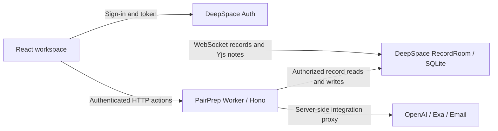

# PairPrep

PairPrep is a collaborative workspace for technical interview practice. Create a private room around a curated coding challenge, invite a partner, and work through your approach in shared notes. After practice, the room owner can mark the session complete, and each participant can save a private self-review.

## Features

- **Practice workspace** with active rooms, completion dates, and links to reviews.
- **Private rooms** with owner-managed invitations and participant removal.
- **Shared notes** with live Yjs synchronization and read/write access based on room membership.
- **AI Coach** for hints, follow-up questions, and feedback, with a saved conversation per user and room and a clear-conversation action.
- **Technical Research** with links returned by Exa.
- **Performance reviews** with a summary, strengths, and areas for improvement.

## Architecture

PairPrep uses React, TypeScript, React Router, Tailwind CSS, and Base UI on the frontend. It runs on Cloudflare Workers with DeepSpace SDK 0.44.2, Hono, and SQLite-backed Durable Objects. Vite builds the Worker and browser bundles and prerenders the public landing page.



The browser subscribes to permission-filtered room, review, and conversation records. The room’s Yjs notes use the records WebSocket and persist in the Durable Object. Server actions implement completion, review creation, invitations, removal, and provider calls. The dashboard derives history from records with an explicit completion marker.

### Security and authorization

- DeepSpace Auth supplies the caller identity. Protected pages require sign-in, and the Worker verifies the bearer token for server actions.
- Privileged record calls bypass collection permissions, so actions check room ownership or active membership before reads, writes, and billable calls. Only owners can invite, remove participants, or complete a session.
- Collection permissions enforce team access to rooms and owner access to personal reviews and coach conversations. Browser clients cannot write membership or review records directly.
- AI Coach and Technical Research share a server-enforced limit of 20 requests per account per UTC hour across rooms. Unique reservations arbitrate concurrent requests. A provider failure after reservation still consumes a slot.
- The coach sends the user’s prompt, challenge context, and recent conversation to OpenAI. Research sends the search query to Exa. Shared notes and self-reviews stay in PairPrep.

## Local development

Use a Node.js and npm version listed in `package.json`, an initialized DeepSpace app, and an authorized DeepSpace developer account.

```sh
npm ci
npm run login
npm run dev
```

Open the URL printed by the CLI. For local rehearsals without paid provider calls or invitation delivery, start the mock-backed development server instead. See [DEMO.md](DEMO.md) for setup and verification.

```sh
PAIRPREP_MOCK_INTEGRATIONS=1 npm run dev -- --host 127.0.0.1
```

### Configuration

| Names | Purpose |
| --- | --- |
| `DEEPSPACE_APP_ID`, `APP_NAME` | Application identity from the Wrangler configuration. |
| `AUTH_WORKER_URL`, `AUTH_JWT_PUBLIC_KEY`, `AUTH_JWT_ISSUER` | DeepSpace authentication endpoint and JWT verification configuration. |
| `OWNER_USER_ID`, `APP_OWNER_JWT`, `APP_IDENTITY_TOKEN` | Platform-supplied owner and app identity. Store credential values privately. |
| `API_WORKER_URL`, `PLATFORM_WORKER_URL` | Local URL fallbacks for the `API_WORKER` and `PLATFORM_WORKER` service bindings. |
| `PAIRPREP_MOCK_INTEGRATIONS` | Set to `1` to bind the local provider mock during Vite development. Playwright sets this automatically. |
| `DEEPSPACE_PORT` | Optional Playwright web-server port. |

DeepSpace supplies local runtime values through its CLI. Keep `.dev.vars` out of source control and shared artifacts. The real integration proxy uses developer billing through DeepSpace. The frontend uses no provider API keys.

## Verification

```sh
npm run type-check
npm run lint
npm run build
npm run test:unit
npm run test:api
npm run test:smoke
npm run test:e2e
git diff --check
```

Vitest covers server actions, authorization, and response handling. The API and smoke suites check local Worker routing and page startup. Playwright covers keyboard room creation, private room access, note synchronization across accounts, mocked provider states, review persistence and privacy, and removal from a live room.

For browser tests, install Chromium with `npx playwright install chromium` if needed and configure two usable DeepSpace test accounts named Alice and Bob. Use `npx deepspace test accounts list` to check your pool. The browser suite uses real DeepSpace sign-in and local app storage. OpenAI, Exa, and email use local mocks, and the collaboration test checks that the mock is active before submitting an invitation.

## Known limitations and future work

- Room calls support two people and use browser WebRTC. The room's authenticated Durable Object relays offers, answers, ICE candidates, and call presence. Audio and video travel peer to peer. PairPrep has no recording or media storage, and leaving stops local capture.
- Calls require HTTPS or localhost and a browser with WebRTC. They default to the public Google STUN endpoint used in the WebRTC examples. STUN discovers network addresses and does not relay media. Set `VITE_CALL_STUN_URL` to a different STUN URL, or to an empty string for host-only local tests. STUN and peers can see connectivity addresses. Calls can fail behind restrictive firewalls or NATs because PairPrep has no TURN relay. No paid video service is configured.

- Run Code executes Python (MicroPython) and JavaScript (QuickJS) in the user's browser. Standard input is available through Python's `input()` and JavaScript's `readLine()`. Java syntax highlighting remains available. Java execution and full CPython package compatibility are outside the browser runner's scope.
- Each execution gets a fresh WebAssembly runtime in a worker owned by an opaque-origin sandboxed iframe. The iframe's CSP blocks network access apart from local blob reads needed to load WASM. QuickJS has no browser bindings and the MicroPython global JS bridge is disabled at bundle time. Jobs have a 3-second execution deadline and 8 KiB per output stream. Each interpreter has a 32 MiB heap limit, but browser memory overhead is outside it. Hostile programs can still consume device resources, particularly if a browser throttles timers or has a security vulnerability.

- One completion is recorded per room. History represents completed rooms visible under current membership, so removing a collaborator removes that room from their history. Returning to an older room does not create a new session.
- Reviews are private, append-only self-reviews. Peer feedback and review editing are possible future work.
- Invitees need a registered PairPrep account. Membership remains active if email delivery fails. A resend flow is future work.
- The coach displays the latest 500 saved messages and uses a smaller recent window for context. Research shows up to five links.
- Membership changes use an app-wide WebSocket reconnect in SDK 0.44.2. A future SDK upgrade can revisit targeted refresh.
- The demo and automated suite exercise mocked provider responses. Production provider behavior and email delivery require separate verification.

## Project repository

[GitHub — Zahid-Attahi/PairPrep](https://github.com/Zahid-Attahi/PairPrep)

Built by Zahid Attahi as a full-stack engineering portfolio project.
